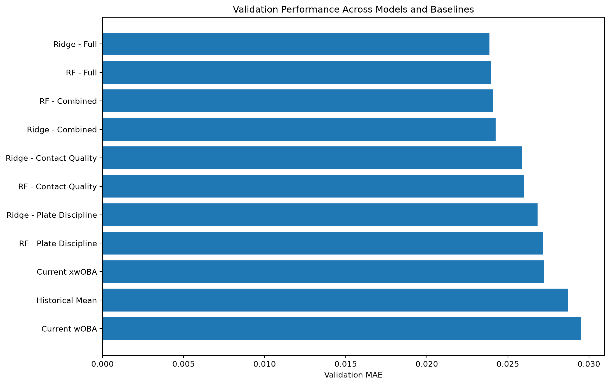
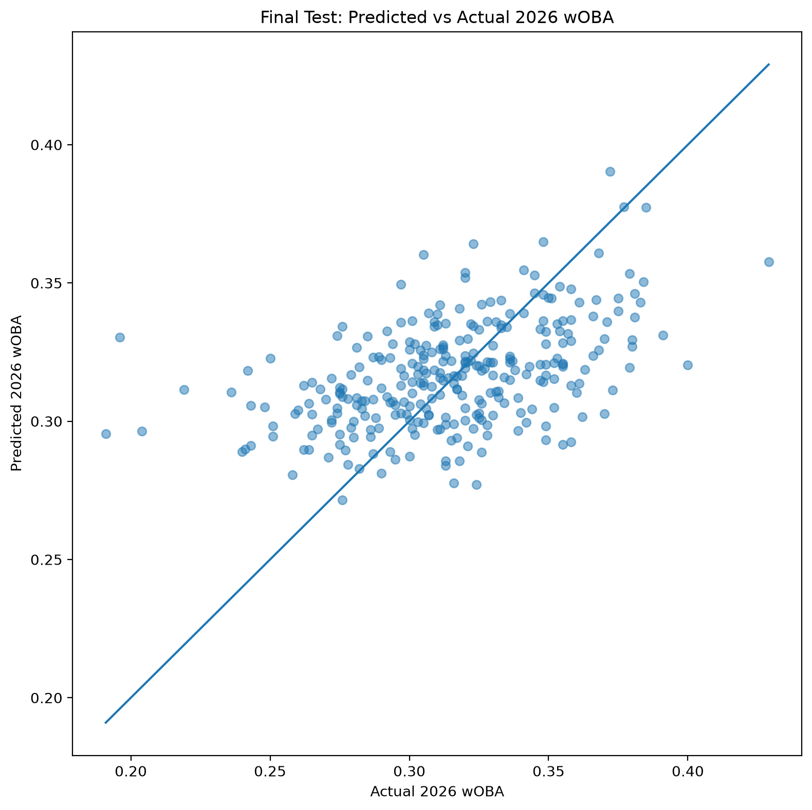
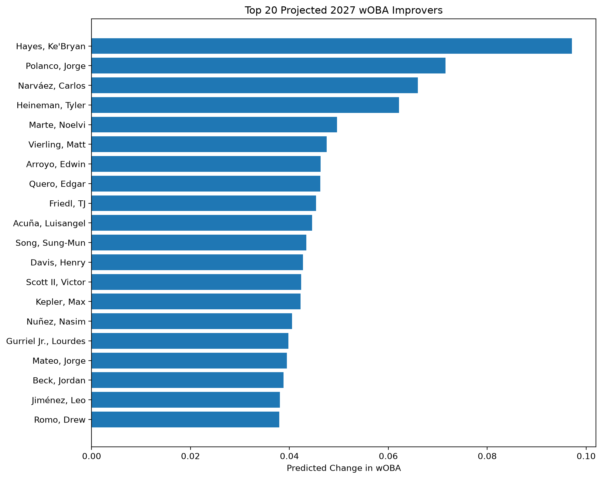
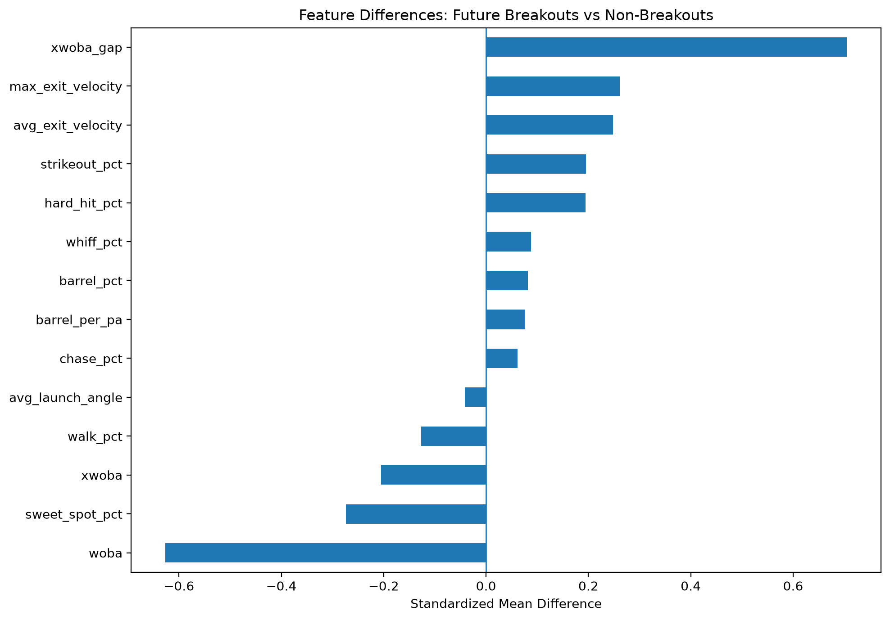

# MLB Hitter Breakout Predictor

A machine-learning project that uses MLB Statcast, plate-discipline, and offensive performance data to predict next-season hitter performance and identify potential breakout candidates.

## Overview

I built this project to investigate whether a hitter's underlying plate discipline and quality of contact can help predict future offensive performance.

I collected and processed multi-season MLB hitter data, engineered features, performed exploratory data analysis, compared multiple predictive models, and evaluated the final model using chronological validation and an untouched future-season test set.

The primary modeling target is **next-season wOBA (weighted On-Base Average)**.

Rather than randomly splitting historical observations, I preserved the time order of MLB seasons so that models were always trained using past data and evaluated on future data.

## Key Results

The final model was a **Ridge Regression model using plate-discipline, contact-quality, wOBA, and xwOBA features**.

On the untouched **2025 → 2026 test set**, the final model achieved:

- **MAE:** 0.0248 wOBA
- **RMSE:** 0.0316
- **R²:** 0.231
- **21.9% lower MAE than using current-season wOBA alone**
- **14.2% lower MAE than using current-season xwOBA alone**

Historical rolling validation produced an average MAE of approximately **0.0258**, which was very similar to the final test result and provided additional evidence that the model generalized across seasons.

## Main Findings

My original hypothesis was that hitters with both elite plate discipline and elite contact quality would be the most likely to experience breakout seasons.

The results showed a more nuanced pattern.

Contact-quality metrics such as **Average Exit Velocity, Maximum Exit Velocity, Hard-Hit%, Barrel%, and Barrels per Plate Appearance** showed meaningful relationships with future offensive performance.

Plate-discipline metrics provided additional information, particularly **Walk% and Chase%**, but were generally weaker predictors on their own.

I also found that hitters with strong plate discipline and contact quality tended to remain strong offensive performers, but they were not necessarily the hitters who experienced the largest year-over-year improvements. Many were already productive and therefore had less room to make the large jump required by my historical breakout definition.

One of the most interesting findings involved the difference between **xwOBA and actual wOBA**. Hitters whose expected performance exceeded their actual results showed stronger future improvement signals, even after I adjusted improvement based on current offensive performance.

Overall, the project suggests that underlying Statcast contact quality and expected-performance metrics contain predictive information beyond simply using a hitter's current traditional results.

## 2027 Hitter Projections

After completing model selection and evaluating the frozen model on the untouched 2025-to-2026 test set, I retrained the final Ridge Regression model using all available historical hitter-season outcomes.

I then applied the model to 2026 hitter data to generate projected 2027 wOBA values.

I created two separate outputs:

- **Overall 2027 hitter projections**, ranked by predicted 2027 wOBA
- **2027 Breakout Watchlist**, ranked by predicted improvement from 2026 wOBA to projected 2027 wOBA

I intentionally treat the Breakout Watchlist as a ranking of potential improvement rather than claiming that every player will meet my historical breakout threshold. Ridge Regression produces conservative point estimates, while actual year-to-year player performance can be much more volatile.

The full projection results are available in:

`data/processed/2027_hitter_predictions.csv`

and:

`data/processed/2027_breakout_watchlist.csv`

### Top Projected 2027 Improvers

Some of the largest projected year-over-year improvements included:

| Player | 2026 wOBA | Projected 2027 wOBA | Projected Change |
|---|---:|---:|---:|
| Ke'Bryan Hayes | .191 | .288 | +.097 |
| Jorge Polanco | .196 | .268 | +.072 |
| Carlos Narváez | .219 | .285 | +.066 |
| Tyler Heineman | .204 | .266 | +.062 |
| Noelvi Marte | .242 | .292 | +.050 |

These predictions should be interpreted as model estimates rather than guarantees. The model does not account for future injuries, playing-time changes, roster moves, aging effects, mechanical adjustments, or other information outside the selected statistical features.

## Data

I collected MLB hitter data from Baseball Savant and Statcast covering multiple seasons from 2016 through 2026.

The dataset combines two main groups of features.

### Plate Discipline

- Walk%
- Strikeout%
- Whiff%
- Chase%

### Contact Quality

- Average Exit Velocity
- Maximum Exit Velocity
- Hard-Hit%
- Barrel%
- Barrels per Plate Appearance
- Sweet-Spot%
- Average Launch Angle

I also included current offensive performance metrics such as:

- wOBA
- xwOBA

Players were merged across data sources using MLB player IDs rather than player names to avoid matching errors.

The final historical modeling dataset contained more than 2,400 usable year-to-year hitter observations.

## Methodology

I organized the project into three main stages.

### 1. Data Collection and Preparation

I collected season-level hitter data, standardized column names, checked for duplicate player IDs and missing values, merged multiple Baseball Savant datasets, and saved both raw and processed versions of the data.

I then matched each hitter-season with that player's following-season performance so that current-season statistics could be used to predict next-season wOBA.

### 2. Exploratory Data Analysis

Before building machine-learning models, I analyzed how individual features related to future offensive performance and breakout seasons.

I compared breakout and non-breakout hitters, created standardized feature comparisons, examined correlations with next-season wOBA, and engineered custom Plate Discipline and Contact Quality scores.

I also tested whether hitters who underperformed their xwOBA were more likely to improve in the following season and adjusted this analysis for the amount of improvement normally expected based on current wOBA.

### 3. Predictive Modeling

I compared several feature sets:

1. Plate-discipline features only
2. Contact-quality features only
3. Combined plate-discipline and contact-quality features
4. A full model including current wOBA and xwOBA

I tested both Ridge Regression and Random Forest Regression.

Instead of randomly splitting observations, I used chronological validation so that models were always trained on past seasons and evaluated on future seasons.

I also compared the machine-learning models against simple baselines, including:

- Current wOBA
- Current xwOBA
- Historical average wOBA

After rolling historical validation, I selected Ridge Regression with the full feature set because it provided strong predictive performance while remaining simpler and more interpretable than Random Forest.

The final model was then evaluated once on the untouched 2025-to-2026 test set.

## Model Performance

I compared multiple modeling approaches and feature sets against simple statistical baselines.

On the 2024-to-2025 validation season, the full Ridge Regression model achieved the lowest prediction error among the tested approaches.

The feature-set comparison also showed that:

- Plate-discipline features improved on the simple current-wOBA baseline.
- Contact-quality features performed better than plate-discipline features alone.
- Combining plate discipline and contact quality improved performance further.
- Adding current wOBA and xwOBA produced the strongest Ridge model.

Random Forest Regression performed similarly to Ridge Regression during rolling validation, but Ridge was selected because it provided comparable accuracy with greater simplicity and interpretability.

### Validation Model Comparison



## Final Untouched Test

After model selection was complete, I evaluated the frozen Ridge Regression model once using 2025 hitter statistics to predict 2026 wOBA.

The final model achieved:

| Metric | Result |
|---|---:|
| MAE | **0.0248** |
| RMSE | **0.0316** |
| R² | **0.231** |
| MAE improvement vs current wOBA | **21.9%** |
| MAE improvement vs current xwOBA | **14.2%** |

The similarity between the final-test MAE and the historical rolling-validation MAE provided additional evidence that the model generalized reasonably well across seasons.

### Predicted vs Actual 2026 wOBA



Points closer to the diagonal line represent more accurate predictions. The plot also illustrates an important limitation of regression models: extreme performances tend to be pulled toward the center of the distribution.

## 2027 Breakout Watchlist

Rather than changing my historical breakout definition to force future players into the same threshold, I rank 2026 hitters by their model-predicted improvement for 2027.

This creates a forward-looking **Breakout Watchlist** while keeping the historical definition unchanged.

### Top Projected 2027 Improvers



The full watchlist is available in:

`data/processed/2027_breakout_watchlist.csv`

## Exploratory Analysis Highlights

One of the strongest findings from the exploratory analysis was that contact-quality metrics generally showed more predictive signal than plate-discipline metrics alone.

### Features Associated With Future Breakouts



The analysis also showed that xwOBA gap had a strong relationship with future improvement. Because both xwOBA gap and year-over-year wOBA change include current wOBA, I performed an additional baseline-adjusted analysis rather than assuming that the relationship represented independent predictive signal.

After controlling for expected improvement based on current wOBA, xwOBA gap and several contact-quality metrics still showed positive relationships with improvement above expectation.

## Project Structure

```text
MLB-breakout-predictor/
│
├── data/
│   ├── raw/
│   │   ├── savant_discipline_2025.csv
│   │   └── statcast_contact_2025.csv
│   │
│   └── processed/
│       ├── all_hitter_seasons.csv
│       ├── training_data.csv
│       ├── training_data_enriched.csv
│       ├── final_test_predictions_2026.csv
│       ├── 2027_hitter_predictions.csv
│       ├── 2027_breakout_watchlist.csv
│       └── season-level hitter feature files
│
├── notebooks/
│   ├── 01_data_collection.ipynb
│   ├── 02_exploratory_analysis.ipynb
│   └── 03_modeling.ipynb
│
├── outputs/
│   └── figures/
│       ├── all_validation_models.png
│       ├── final_test_actual_vs_predicted.png
│       ├── 2027_breakout_watchlist.png
│       └── additional exploratory-analysis figures
│
├── src/
│
├── .gitignore
├── README.md
└── requirements.txt
```

### Notebook Workflow

**01_data_collection.ipynb**

- Collects Statcast and Baseball Savant data
- Cleans and standardizes variables
- Merges data using MLB player IDs
- Builds multi-season hitter datasets
- Constructs next-season prediction targets
- Defines the historical breakout label

**02_exploratory_analysis.ipynb**

- Examines feature distributions and missing values
- Compares future breakout and non-breakout hitters
- Studies relationships between current statistics and future wOBA
- Engineers Plate Discipline and Contact Quality scores
- Tests xwOBA gap and baseline-adjusted improvement

**03_modeling.ipynb**

- Establishes simple prediction baselines
- Trains Ridge Regression and Random Forest models
- Compares plate-discipline, contact-quality, combined, and full feature sets
- Uses chronological and rolling historical validation
- Evaluates the final frozen model on an untouched future-season test
- Generates 2027 hitter projections and the Breakout Watchlist

## Technologies Used

- **Python**
- **pandas** for data cleaning, transformation, merging, and analysis
- **NumPy** for numerical operations
- **Matplotlib** for data visualization
- **scikit-learn** for preprocessing, Ridge Regression, Random Forest Regression, and model evaluation
- **pybaseball** for Statcast data collection
- **Baseball Savant / Statcast** as the primary baseball data source
- **Jupyter Notebooks**
- **VS Code**
- **Git / GitHub**

## How to Run the Project

Clone the repository and move into the project folder:

```bash
git clone <repository-url>
cd MLB-breakout-predictor
```

Create a Python virtual environment:

```bash
python3 -m venv .venv
```

Activate it on macOS or Linux:

```bash
source .venv/bin/activate
```

Install the required packages:

```bash
python -m pip install -r requirements.txt
```

Then run the notebooks in order:

```text
01_data_collection.ipynb
02_exploratory_analysis.ipynb
03_modeling.ipynb
```

The first notebook builds the datasets, the second performs exploratory analysis and feature engineering, and the third trains and evaluates the predictive models.

## Limitations

This project has several important limitations.

First, the model only uses the statistical variables included in the dataset. It does not account for injuries, mechanical changes, coaching changes, roster moves, aging curves, ballpark changes, playing-time expectations, or other contextual information that could affect future performance.

Second, hitter performance contains substantial year-to-year randomness. Even though the final model improved substantially over simple baselines, an MAE of approximately 0.025 wOBA still represents meaningful uncertainty at the individual-player level.

Third, the project uses season-level aggregated statistics. More granular pitch-level or batted-ball-level data could potentially capture additional information that season-level averages miss.

The model also tends to produce conservative predictions. Ridge Regression pulls extreme estimates toward the center of the distribution, meaning that actual breakout or collapse seasons may be more extreme than the model predicts.

Finally, the relationships identified in this project are predictive associations and should not automatically be interpreted as causal relationships.

## Future Improvements

Possible future extensions include:

- Adding player age and aging-curve information
- Incorporating playing-time projections
- Testing additional Statcast variables
- Using pitch-level or batted-ball-level data
- Adding handedness and platoon information
- Testing additional model families
- Creating prediction intervals to represent uncertainty
- Developing separate models for different hitter profiles
- Building an interactive dashboard for exploring hitter projections
- Evaluating the 2027 predictions once actual 2027 performance becomes available

## Project Goal

My goal with this project was not only to generate MLB predictions, but to build a complete data-science workflow from raw data collection through final model evaluation.

The project gave me experience with data collection, cleaning, feature engineering, exploratory analysis, statistical reasoning, machine learning, time-aware validation, model comparison, interpretation, and communicating results.

Most importantly, I focused on testing whether increasingly complex approaches actually improved future-season prediction rather than assuming that a more complicated model would automatically be better.